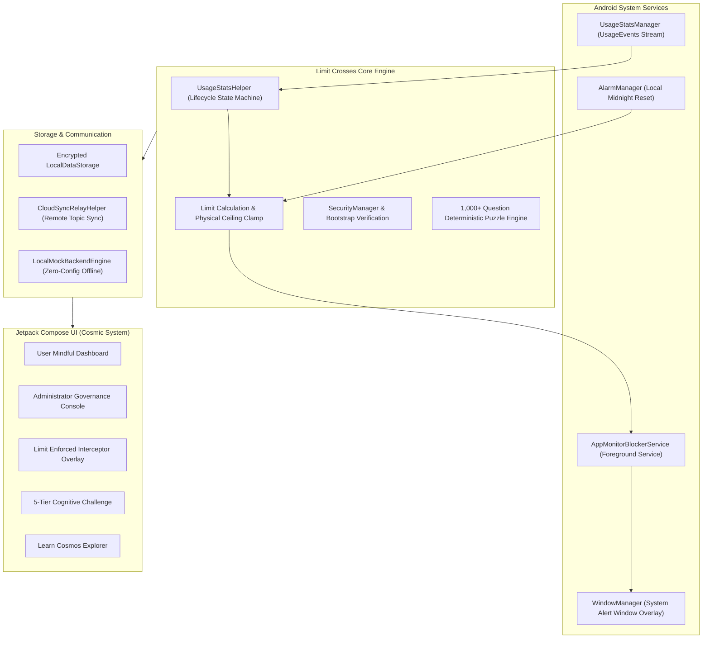

# Limit Crosses

[](https://kotlinlang.org)
[](https://developer.android.com/jetpack/compose)
[-brightgreen.svg?style=for-the-badge)](https://developer.android.com)
[](https://developer.android.com)
[](https://developer.android.com)
[](https://developer.android.com)
[](https://github.com/pankaj26-cmd)

> **Mindful Digital Boundaries — Transparent, Unified Social Usage Enforcer for Android**  
> *Crafted with mindful focus by **Pankaj Yadav**.*

---

## 🌟 Overview & Product Vision

Most digital wellbeing and screen-time limiters suffer from two fatal weaknesses:
1. **Siloed App Limits:** They restrict apps individually (e.g., 45 minutes on Instagram, 45 minutes on Facebook, 45 minutes on Snapchat = over 2 hours of doomscrolling).
2. **Frictionless Snoozing:** Users can effortlessly tap *"Ignore for 15 minutes"* with zero cognitive resistance.

**Limit Crosses** changes the equation through a strict, respectful architectural model:
- **Combined Daily Cap (0–45 mins Total):** Facebook, Instagram, and Snapchat draw from a **single shared pool**. 25 minutes on Instagram leaves only 20 minutes for both Facebook and Snapchat combined.
- **Immediate Foreground Interception:** When the allowance hits zero, a high-priority system overlay and blocker immediately intercepts social apps, replacing dopamine loops with mindful reflection.
- **Cognitive Verification Puzzles (1,000+ Questions):** To request extra allowance from an Administrator, users cannot simply tap a button. They must solve a 5-level cognitive test drawn randomly from a vast bank of 1,000+ STEM, physics, astronomy, and logic challenges.
- **Learn Cosmos Mindfulness Hub:** Features verified space exploration and astrophysics topics backed by authentic **NASA** and **ESA** research, redirecting idle screen impulses toward meaningful learning.

---

## 🚀 Architectural Highlights



### 1. High-Precision AOSP Telemetry State Machine
Traditional apps poll `queryUsageStats(INTERVAL_DAILY)` which creates overlapping bucket errors and phantom minutes. **Limit Crosses** implements an event-driven lifecycle parser using low-level `UsageEvents`:
* **Strict Pairing:** Explicitly pairs `ACTIVITY_RESUMED` with subsequent `ACTIVITY_PAUSED` events.
* **Ghost Event Elimination:** Ignores orphaned `ACTIVITY_STOPPED` system memory trims and eliminates midnight timestamp fallbacks that typically corrupt screen-time calculations.
* **Physical Time Ceiling Clamp:** Mathematically enforces that accumulated daily usage cannot exceed physical seconds elapsed since midnight:
  $$\text{usageSeconds} \le \text{System.currentTimeMillis()} - \text{todayMidnightEpochMs}$$

### 2. Zero-Accessibility Architecture (Play Protect Compliant)
Many monitoring utilities request Android's `BIND_ACCESSIBILITY_SERVICE` permission, triggering severe Google Play Protect security warnings and battery drain. Limit Crosses uses strictly sanctioned system capabilities:
- `android.permission.PACKAGE_USAGE_STATS` (Screen time measurement)
- `android.permission.SYSTEM_ALERT_WINDOW` (Limit overlay display)
- `android.permission.FOREGROUND_SERVICE_SPECIAL_USE` (Persistent monitoring)

### 3. Multi-Tenant Remote Administration & Governance
* **Master Bootstrap Secret:** Initial Administrator provisioning is strictly gated by a secure deployment master key (`LIMIT-CROSS-ADMIN-BOOTSTRAP-2026`).
* **Cryptographic Invites:** Users join exclusively through cryptographic invite codes (`LC-XXXX-XXXX`) generated by the Admin.
* **Remote Policy Locking:** Admins can lock the daily cap, view real-time breakdown telemetries of all users, approve/deny extension requests, and process GDPR-style account deletion requests.
* **Full Audit Trail:** All administrative and lifecycle actions are recorded with timestamps, actor roles, and audit reasons.

### 4. Dual Sync Engine (Cloud Relay + Offline Mode)
* **Cloud Sync Relay:** End-to-end telemetry and request synchronization across remote devices using secure topic relays without third-party account linkage.
* **Offline Base64 Sync Payload:** Air-gapped fallback allowing users to export encrypted registration sync codes (`LCR-...`) directly to their Admin.

---

## 🎨 Design System: Cosmic & Solar Dawn

Limit Crosses features a purpose-built design system crafted entirely in Jetpack Compose:
* **Deep Cosmic Theme (Default):** Deep space nebula palette (`#070A14` void, `#16223E` glassmorphism card surfaces, `#8B5CF6` primary violet, `#00E5FF` cyan accent).
* **Solar Dawn Light Theme:** High-contrast crisp daylight mode (`#F1F5F9` canvas, `#FFFFFF` cards, `#6D28D9` deep violet, `#B45309` amber gold contrast).
* **Bilingual Localization:** Full first-class string localization in **English** and **Hindi (हिंदी)** with instantaneous in-app switching.

---

## 💻 Tech Stack & Dependencies

| Layer | Technologies |
|---|---|
| **Language** | Kotlin 2.0.21 |
| **UI Framework** | Jetpack Compose, Material 3, Compose Navigation |
| **Asynchronous Engine** | Kotlin Coroutines, StateFlow, SharedFlow |
| **Dependency Injection** | Koin 3.5.6 (Kotlin-native DI) |
| **System APIs** | UsageStatsManager, WindowManager, Foreground Services, AlarmManager |
| **Educational Web** | AndroidX Custom Tabs (NASA & ESA verified viewers) |
| **Testing** | JUnit 4, Kotlinx Coroutines Test, Automated Unit Suites |

---

## 🛠️ Build & Installation

### Prerequisites
* **JDK 21 LTS** (Eclipse Adoptium Temurin 21 recommended)
* **Android SDK** (API 26 through 35/37)
* Windows PowerShell or Linux/macOS Bash

### 1. Clone & Build
```bash
# Clone the repository
git clone https://github.com/pankaj26-cmd/limit-crosses.git
cd limit-crosses

# Set JAVA_HOME (Windows example)
$env:JAVA_HOME = "C:\Program Files\Eclipse Adoptium\jdk-21.0.13.9-hotspot"

# Run unit tests
.\gradlew.bat testDebugUnitTest

# Assemble Debug APK
.\gradlew.bat assembleDebug
```

The output APK will be generated at:
```
app/build/outputs/apk/debug/app-debug.apk
```

### 2. Quick Deploy via ADB
```bash
adb install -r app/build/outputs/apk/debug/app-debug.apk
adb shell am start -n com.limitcrosses.app/.MainActivity
```

---

## 🧪 Automated Unit Test Suites

The codebase includes automated unit test suites covering core business logic:
* `LimitCalculationTest.kt`: Tests boundary constraints, 0–45m caps, physical ceiling clamping, and lifecycle event pairing.
* `PuzzleLogicTest.kt`: Validates deterministic evaluation, failure penalties, and 1,000+ randomized question bank integrity.
* `SecurityManagerTest.kt`: Verifies cryptographic password hashing, invite code generator entropy, and admin master key verification.
* `CloudSyncRelayTest.kt`: Tests JSON serialization, telemetry payloads, and offline sync encoding/decoding.

---

## 👤 Author & Attribution

**Pankaj Yadav**  
* GitHub: [@pankaj26-cmd](https://github.com/pankaj26-cmd)  
* Project: **Limit Crosses**  

*Designed and crafted with mindful focus by Pankaj Yadav.*
